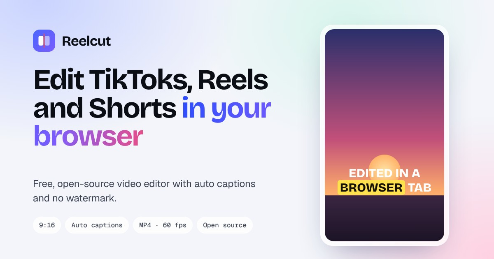

# Reelcut

A free, open-source video editor that runs in your browser. Edit TikToks, Reels and Shorts with a multi-track timeline, on-device auto captions and 9:16 presets. There is nothing to install, no watermark on export, and your footage stays on your device.



Reelcut is a redesigned fork of [OpenCut](https://github.com/OpenCut-app/opencut-classic), released under the same MIT license. Credit for the editor engine goes to the OpenCut team.

## Features

- Multi-track timeline for video, audio and text, with ripple editing
- Auto captions with Whisper running in the browser (4 models, 9 languages)
- Canvas presets: 9:16, 1:1, 16:9 and 4:3
- Speed, masks and blur
- Sound effects from Freesound (optional API key)
- Export to MP4 or WebM, 24 to 120 fps, no watermark
- Projects saved in the browser (IndexedDB and OPFS), nothing uploaded
- Email-gated access: visitors leave an email on the landing page to open the editor

## How the email gate works

1. The landing page (`apps/web/public/landing.html`, served at `/`) posts the email to `POST /api/subscribe`.
2. The email is stored in Upstash Redis in the hash `reelcut:emails` with the signup time.
3. The response sets an HttpOnly cookie `reelcut_access`, signed with HMAC-SHA256 using `ACCESS_SECRET`.
4. `apps/web/src/proxy.ts` checks that cookie on `/projects` and `/editor/*` and sends visitors without it back to the form.
5. `GET /api/emails?key=ADMIN_KEY` downloads every signup as CSV.

If `ACCESS_SECRET` is not set, emails are still saved but the editor stays open to everyone.

## Deploy on Vercel

1. Import this repository in Vercel and set the **Root Directory** to `apps/web`.
2. In the project, open **Storage → Upstash for Redis → Create**. This adds `UPSTASH_REDIS_REST_URL` and `UPSTASH_REDIS_REST_TOKEN`.
3. Add the remaining environment variables and redeploy.

| Variable | Required | What it does |
| --- | --- | --- |
| `UPSTASH_REDIS_REST_URL` | yes | Upstash REST URL (added by the integration) |
| `UPSTASH_REDIS_REST_TOKEN` | yes | Upstash REST token (added by the integration) |
| `ACCESS_SECRET` | yes, for the gate | Random string of 32+ characters used to sign the access cookie |
| `ADMIN_KEY` | yes, for the CSV | Password for `/api/emails?key=...` |
| `NEXT_PUBLIC_SITE_URL` | recommended | Your public URL, used in metadata and the sitemap |
| `EDITOR_URL` | no | Where "Open the editor" points. Defaults to `/projects` |
| `FREESOUND_CLIENT_ID`, `FREESOUND_API_KEY` | no | Enables sound effect search |

Generate secrets with `openssl rand -base64 32`.

## Run locally

Requires [Bun](https://bun.sh).

```bash
bun install
cp apps/web/.env.example apps/web/.env.local   # then fill in the values
bun dev:web                                      # http://localhost:3000
```

For a local Redis, `docker compose up -d redis serverless-redis-http` starts an Upstash-compatible REST server on port 8079.

Run the tests with `bun test`.

## License

MIT. See [LICENSE](LICENSE) for the original OpenCut copyright notice and [NOTICE](NOTICE) for attribution.
